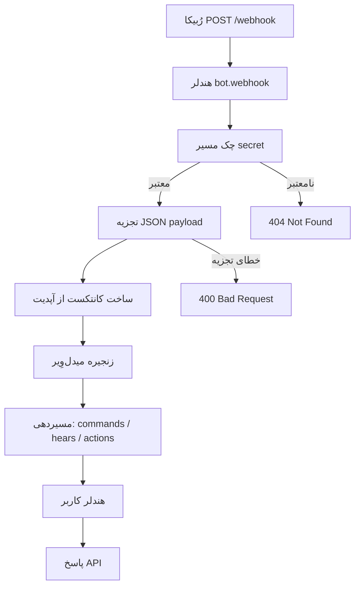

<div align="center" dir="rtl">
  <h1>rubika-cf</h1>
  <p><strong>یک کتابخانه تایپ‌اسکریپت بدون وابستگی برای ساخت ربات‌های روبیکا روی کلادفلر ورکرز.</strong></p>
  <p>
    <!-- نشان‌ها - TODO: جایگزین با موارد واقعی بعد از انتشار -->
    
    
    
    
  </p>
</div>

**rubika-cf** یک فریم‌ورک ربات روبیکا مینیمال، تایپ‑سیف و نوشته شده با تایپ‌اسکریپت است که برای استقرار بر روی کلادفلر ورکرز با وب‌هُک طراحی شده. این کتابخانه API میدل‌وِیر مبتنی را که از grammY و Telegraf الهام گرفته شده، با صفر وابستگی زمان اجرا و یکپارچگی کامل با کلادفلر ارائه می‌دهد.

---

## امکانات

| امکان                 | توضیح                                                                                                              |
| --------------------- | ------------------------------------------------------------------------------------------------------------------ |
| **بدون وابستگی**      | تنها `fetch` و گلوبال‌های استاندارد؛ هیچ بسته NPM اضافه‌ای                                                         |
| **تایپ‌اسکریپت کامل** | تایپ‌های دقیق برای آپدیت‌ها، کانتکست، کیپدها و پاسخ‌های API                                                        |
| **زنجیره میدل‌وِیر**  | ترکیب منطق قابل استفاده مجدد با `bot.use(fn)`                                                                      |
| **مسیردهی دستور**     | `bot.command('start', handler)` با تجزیه آرگومان خودکار                                                            |
| **پایگان متن**        | `bot.hears('text' \| RegExp, handler)` برای تطابق دقیق یا الگو                                                     |
| **دکمه‌های اینلاین**  | `bot.action('button_id', handler)` برای کوئری‌های کال‌بک                                                           |
| **هندلر رویداد**      | `bot.on('message' \| 'inline' \| 'started' \| 'stopped' \| 'update', handler)`                                     |
| **مرزهای خطا**        | `bot.catch(async (err, ctx) => { ... })` برای کنترل خطای متمرکز                                                    |
| **کانتکست غنی**       | `ctx.reply()`, `ctx.replyWithFile()`, `ctx.editText()`, `ctx.deleteMessage()`, `ctx.forwardMessage()`, `ctx.state` |
| **سازنده کیپد**       | `KeypadBuilder` روان + فکتوری `keypad()` برای کیبورد ریپلای/اینلاین                                                |
| **آماده وب‌هُک**      | `bot.webhook({ secret })` هندلر fetch سازگار با کلادفلر برمی‌گرداند                                                |
| **راهنما setWebhook** | `await bot.setWebhook(url)` وب‌هُک را در API روبیکا ثبت می‌کند                                                     |

---

## نصب

```bash
# npm
npm install rubika-cf

# pnpm
pnpm add rubika-cf

# yarn
yarn add rubika-cf

# bun
bun add rubika-cf
```

> **نکته:** نیازمند TypeScript 5.0+ و رانتایم با `fetch` گلوبال (کلادفلر ورکرز، Bun، Node 18+، Deno).

---

## راهنمای سریع

### ورکر مینیمال

**worker.ts**

```ts
import { Bot, type ExecutionContextLike } from "rubika-cf";

interface Env {
  BOT_TOKEN: string;
  WEBHOOK_SECRET: string;
}

const createBot = (token: string) => {
  const bot = new Bot(token);

  bot.command("start", async (ctx) => {
    await ctx.reply("سلام! من یک ربات روبیکا هستم.");
  });

  bot.command("echo", async (ctx) => {
    await ctx.reply(ctx.args.join(" ") || "چی بگم؟");
  });

  return bot;
};

export default {
  async fetch(
    request: Request,
    env: Env,
    ctx: ExecutionContextLike,
  ): Promise<Response> {
    const bot = createBot(env.BOT_TOKEN);
    const handler = bot.webhook({ secret: env.WEBHOOK_SECRET });
    return handler(request, ctx);
  },
};
```

### وب‌هُک روی کلادفلر ورکرز

**wrangler.toml**

```toml
name = "my-rubika-bot"
main = "worker.ts"
compatibility_date = "2024-01-01"

# فضای نام KV برای ذخیره جلسه در صورت نیاز
# kv_namespaces = [{ binding = "SESSIONS", id = "..." }]
```

**استقرار و تنظیم سیکرت‌ها:**

```bash
wrangler deploy
wrangler secret put BOT_TOKEN
wrangler secret put WEBHOOK_SECRET
```

**ثبت وب‌هُک (اسکریپت یک‌باره):**

```ts
// scripts/set-webhook.ts
import { Bot } from "rubika-cf";

const token = process.env.BOT_TOKEN!;
const workerUrl = process.env.WORKER_URL!; // مثل https://my-bot.workers.dev
const secret = process.env.WEBHOOK_SECRET!;

const bot = new Bot(token);
// مسیر وب‌هُک /{secret} است، بنابراین URL کامل با پیشوند secret ثبت می‌شود
await bot.setWebhook(`${workerUrl}/${secret}`);

console.log("Webhook registered:", `${workerUrl}/${secret}`);
```

> **چرا `${workerUrl}/${secret}`؟** هندلر `bot.webhook({ secret })` فقط درخواست‌هایی را پردازش می‌کند که مسیرشان با `/${secret}` آغاز شود. روبیکا آپدیت‌ها را به URL کامل ثبت شده POST می‌کند، بنابراین secret باید بخش مسیر باشد.

---

## مفاهیم اصلی

### جریان درخواست



### دستورات

```ts
bot.command("start", async (ctx) => {
  await ctx.reply("خوش آمدید!");
});

// چند دستور، یک هندلر
bot.command(["help", "about"], async (ctx) => {
  await ctx.reply("متن راهنما...");
});

// دسترسی به آرگومان‌های تجزیه شده: /echo hello world → ctx.args = ['hello', 'world']
bot.command("echo", async (ctx) => {
  await ctx.reply(ctx.args.join(" ") || "چی بگم؟");
});
```

### hears (پایگان متن)

```ts
bot.hears("ping", async (ctx) => {
  await ctx.reply("pong");
});

// تطابق RegExp — ctx.match حاوی RegExpMatchArray است
bot.hears(/^\/calc (\d+) ([+\-*/]) (\d+)$/, async (ctx) => {
  const match = ctx.match;
  if (!match) return;
  const a = Number(match[1]);
  const op = match[2];
  const b = Number(match[3]);

  let result: number;
  switch (op) {
    case "+":
      result = a + b;
      break;
    case "-":
      result = a - b;
      break;
    case "*":
      result = a * b;
      break;
    case "/":
      result = b !== 0 ? a / b : NaN;
      break;
    default:
      return;
  }

  await ctx.reply(`Result: ${result}`);
});
```

### اکشن‌ها (دکمه‌های اینلاین)

```ts
// ارسال پیام با کیپد اینلاین
bot.command("menu", async (ctx) => {
  const kb = keypad([
    [
      ["btn_hello", "سلام"],
      ["btn_bye", "خداحافظ"],
    ],
  ]);
  await ctx.reply("انتخاب کنید:", { inline_keypad: kb });
});

// مدیریت فشار دکمه
bot.action("btn_hello", async (ctx) => {
  await ctx.reply("سلام! 👋");
});

bot.action(/^btn_/, async (ctx) => {
  // با هر دکمه‌ای که با "btn_" شروع شود تطابق دارد
  await ctx.reply(`شما فشردید: ${ctx.buttonId}`);
});
```

### میدل‌وِیر

```ts
// میدل‌وِیر لاگ‌گیری
bot.use(async (ctx, next) => {
  const start = Date.now();
  await next();
  console.log(`${ctx.type} handled in ${Date.now() - start}ms`);
});

// محافظ احراز هویت
bot.use(async (ctx, next) => {
  const adminIds = ["123456", "789012"];
  const senderId = "senderId" in ctx ? (ctx as any).senderId : undefined;
  if (senderId && adminIds.includes(senderId)) {
    await next();
  } else {
    await ctx.reply("غیرمجاز");
  }
});

// وضعیت در هر درخواست
bot.use(async (ctx, next) => {
  ctx.state.visits = (ctx.state.visits as number | undefined) ?? 0;
  ctx.state.visits++;
  await next();
});
```

### مدیریت خطا

```ts
bot.catch(async (err, ctx) => {
  console.error("[rubika-cf]", err);
  try {
    await ctx.reply("⚠️ خطایی رخ داد. لطفاً دوباره تلاش کنید.");
  } catch {
    // نادیده گرفتن خطای پاسخ
  }
});
```

### API کانتکست

| ویژگی / متد                               | نوع                        | توضیح                                      |
| ----------------------------------------- | -------------------------- | ------------------------------------------ |
| `ctx.api`                                 | `RubikaApi`                | دسترسی مستقیم به API                       |
| `ctx.chatId`                              | `string`                   | شناسه چت جاری                              |
| `ctx.senderId`                            | `string \| undefined`      | شناسه کاربر فرستنده (کانتکست پیام/اینلاین) |
| `ctx.text`                                | `string`                   | متن پیام (رشته خالی اگر نداشته باشد)       |
| `ctx.command`                             | `string \| undefined`      | نام دستور تجزیه شده (بدون `/`)             |
| `ctx.args`                                | `string[]`                 | آرگومان‌های دستور                          |
| `ctx.match`                               | `RegExpMatchArray \| null` | آخرین تطابق regex از `hears`/`action`      |
| `ctx.state`                               | `Record<string, unknown>`  | حالت قابل تغییر در هر درخواست              |
| `ctx.reply(text, extra?)`                 | `Promise`                  | ارسال پیام متنی                            |
| `ctx.replyWithFile(fileId, extra?)`       | `Promise`                  | ارسال فایل با `file_id`                    |
| `ctx.editText(messageId, text)`           | `Promise`                  | ویرایش متن پیام                            |
| `ctx.editKeypad(messageId, keypad)`       | `Promise`                  | ویرایش کیپد اینلاین                        |
| `ctx.deleteMessage(messageId)`            | `Promise`                  | حذف پیام                                   |
| `ctx.forwardMessage(messageId, toChatId)` | `Promise`                  | فوروارد پیام                               |

### سازنده کیپد

```ts
import { KeypadBuilder, keypad, button } from "rubika-cf";

// بیلدر روان
const kb = new KeypadBuilder()
  .row(button("a", "A"), button("b", "B"))
  .row(button("c", "C"))
  .resized(true)
  .oneTimeUse(true)
  .build();

// فکتوری سریع اینلاین
const kb2 = keypad(
  [
    [
      ["btn1", "گزینه ۱"],
      ["btn2", "گزینه ۲"],
    ],
    [["btn3", "گزینه ۳"]],
  ],
  { resize: true, oneTime: true },
);

// ارسال با پیام
await ctx.reply("انتخاب کنید:", { inline_keypad: kb2 });

// کیبورد ریپلای (چت کیپد)
await ctx.reply("انتخاب کنید:", { chat_keypad: kb2, chat_keypad_type: "New" });
```

---

<details>
<summary><strong>مرجع API</strong></summary>

### کلاس Bot

```ts
new Bot(token: string, options?: RubikaBotOptions)
```

**گزینه‌ها:**
| گزینه | نوع | پیش‌فرض | توضیح |
|--------|------|---------|---------|
| `ignoreBotMessages` | `boolean` | `true` | نادیده گرفتن پیام‌های ارسال شده توسط ربات‌ها |
| `baseUrl` | `string` | `'https://botapi.rubika.ir/v3'` | URL پایه API |
| `timeoutMs` | `number` | `15000` | تایم‌اوت درخواست به میلی‌ثانیه |
| `fetch` | `typeof fetch` | `globalThis.fetch` | پیاده‌سازی fetch سفارشی |

### متدها

| متد                         | توضیح                                                                            |
| --------------------------- | -------------------------------------------------------------------------------- |
| `bot.use(fn)`               | افزودن میدل‌وِیر                                                                 |
| `bot.command(names, fn)`    | ثبت هندلر دستور(ها)                                                              |
| `bot.hears(match, fn)`      | ثبت هندلر تطابق متن                                                              |
| `bot.action(match, fn)`     | ثبت هندلر دکمه اینلاین                                                           |
| `bot.on(event, fn)`         | ثبت هندلر رویداد (`'message'`, `'inline'`, `'started'`, `'stopped'`, `'update'`) |
| `bot.catch(fn)`             | تنظیم هندلر خطای سراسری                                                          |
| `bot.webhook({ secret })`   | ساخت هندلر fetch وب‌هُک                                                          |
| `bot.setWebhook(url)`       | ثبت URL وب‌هُک در API روبیکا                                                     |
| `bot.handleUpdate(payload)` | پردازش دستی آپدیت                                                                |

### گزینه‌های کیپد

فکتوری `keypad()` می‌پذیرد:

```ts
keypad(rows, { resize?: boolean, oneTime?: boolean })
```

این به `Keypad.resize_keyboard` و `Keypad.one_time_keyboard` نگاشت می‌شود.

### کلاینت API

```ts
const api = new Bot(token).api;

await api.sendMessage({ chat_id, text });
await api.editMessageText({ chat_id, message_id, text });
await api.deleteMessage({ chat_id, message_id });
await api.getUpdates({ offset_id, limit });
await api.setWebhook(url);
```

</details>

---

## راهنمای استقرار

### کلادفلر ورکرز

1. نصب Wrangler: `npm install -g wrangler`
2. لاگین: `wrangler login`
3. инициализация: `wrangler init my-rubika-bot`
4. پیکربندی `wrangler.toml` همانند بالا
5. افزودن سیکرت‌ها: `wrangler secret put BOT_TOKEN` و `wrangler secret put WEBHOOK_SECRET`
6. استقرار: `wrangler deploy`
7. ثبت وب‌هُک با اسکریپت یک‌باره (بخش راهنمای سریع)

**هرگز توکن را در کد منبع هاردکد نکنید.** همیشه از سیکرت‌های Wrangler با `env.BOT_TOKEN` استفاده کنید.

### چند ربات روی یک ورکر

هر ربات می‌تواند مسیر secret مخصوص به خود داشته باشد:

```ts
import { Bot, type ExecutionContextLike } from "rubika-cf";

interface Env {
  BOT_A_TOKEN: string;
  BOT_A_SECRET: string;
  BOT_B_TOKEN: string;
  BOT_B_SECRET: string;
}

const createBot = (token: string) => {
  const bot = new Bot(token);
  bot.command("start", async (ctx) => {
    await ctx.reply("سلام از این ربات!");
  });
  return bot;
};

export default {
  async fetch(
    request: Request,
    env: Env,
    ctx: ExecutionContextLike,
  ): Promise<Response> {
    const url = new URL(request.url);
    const path = url.pathname;

    if (path.startsWith(`/${env.BOT_A_SECRET}`)) {
      const bot = createBot(env.BOT_A_TOKEN);
      return bot.webhook({ secret: env.BOT_A_SECRET })(request, ctx);
    }

    if (path.startsWith(`/${env.BOT_B_SECRET}`)) {
      const bot = createBot(env.BOT_B_TOKEN);
      return bot.webhook({ secret: env.BOT_B_SECRET })(request, ctx);
    }

    return new Response("Not found", { status: 404 });
  },
};
```

ثبت جداگانه وب‌هُک برای هر ربات:

```bash
# ربات A
await botA.setWebhook(`https://worker.dev/${BOT_A_SECRET}`);

# ربات B
await botB.setWebhook(`https://worker.dev/${BOT_B_SECRET}`);
```

---

## نقشه راه

> امکانات برنامه‌ریزی شده. این‌ها **هنوز پیاده‌سازی نشده‌اند**.

- [ ] آپدیتر لنگ‌پالینگ برای توسعه محلی
- [ ] آداپترهای ذخیره جلسه (KV، D1، Durable Objects)
- [ ] جریان‌های مکالمه / جادوگر
- [ ] محدودیت نرخ و تلاش مجدد با بک‌اف نمایی
- [ ] راهنما آپلود فایل (`replyWithPhoto(buffer)`)
- [ ] کمپوزر / روتر برای تفکیک هندلرها
- [ ] اسکافولدر CLI `create-rubika-bot`
- [ ] ابزارهای تست / API موک
- [ ] پشتیبانی i18n فارسی

---

## مشارکت

1. ریپازیتوری را فورک کنید
2. شاخه ویژگی بسازید: `git checkout -b feat/amazing-feature`
3. تایپ‌چک اجرا کنید: `bun run typecheck`
4. PR با توضیح شفاف ارسال کنید

---

## مجوز

MIT © [hadi-rostami](https://github.com/hadi-rostami)

---